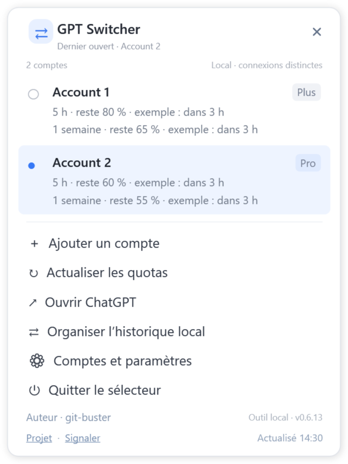
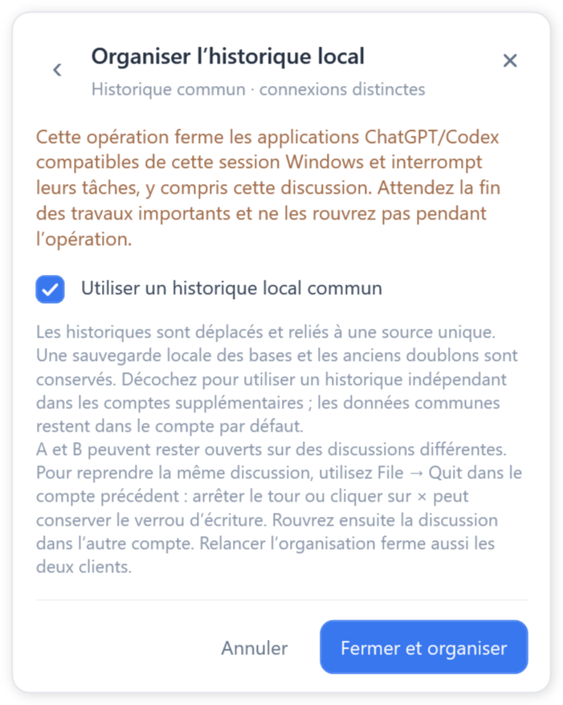

# Historique local commun

GPT Switcher 0.6.14 · Auteur : git-buster

Nécessite Windows 10/11, .NET Framework 4.8 et un client officiel complet compatible, avec son outil Codex officiel. L’historique commun nécessite un disque local adapté, généralement NTFS. Les clients incompatibles sont refusés lors de la vérification.

1. Quittez l’ancienne version du switcher, puis lancez **ChatGPTAccountSwitcher.exe** dans ce dossier. Conservez le fichier `.exe.config` à côté. Aucune installation n’est nécessaire.
2. Cliquez sur l’icône de notification, avec l’un ou l’autre bouton, puis choisissez **Organiser l’historique local**.
3. Laissez **Utiliser un historique local commun** coché. Attendez la fin des travaux importants avant de confirmer **Fermer et organiser** : toutes les applications officielles ChatGPT/Codex compatibles de cette session Windows seront fermées, y compris cette discussion. Le switcher reste ouvert. Ne relancez pas les clients pendant l’opération.
4. Attendez le message de fin, puis ouvrez vos comptes. Les comptes existants et les nouveaux comptes vides utilisent automatiquement la même source locale. Un compte ayant déjà un historique indépendant nécessite une nouvelle organisation hors ligne.
5. A et B peuvent travailler simultanément sur des discussions différentes. Pour reprendre la même discussion dans B, utilisez **File → Quit** dans A, puis rouvrez la discussion dans B. Arrêter le tour ou cliquer sur × peut conserver le verrou d’écriture de A. Relancer l’organisation ferme aussi les deux clients, avant de rouvrir le compte souhaité. Une génération encore en cours n’est pas transférée.

L’historique est regroupé, sans copie complète par compte. La dernière opération conserve une sauvegarde des bases et les doublons remplacés ; une organisation ultérieure réussie supprime les anciennes sauvegardes identifiées par le programme. Les connexions restent distinctes. Les projets locaux sont vérifiés pendant l’organisation ; les fenêtres ouvertes peuvent nécessiter une réouverture de la discussion.

Un conflit ou une source manquante interrompt l’opération et conserve les originaux et informations de récupération. Si une récupération est demandée, gardez les clients fermés et relancez l’organisation. Décochez le partage pour démarrer un historique indépendant dans les comptes supplémentaires ; l’historique commun reste dans le compte par défaut. Utilisez ensuite v0.6.14 ou une version ultérieure.

## Installation, comptes et chemin du client

La version portable s’exécute après extraction du ZIP ; conservez le fichier de configuration à côté de l’EXE. Le MSI installe pour l’utilisateur Windows actuel et crée des raccourcis sur le bureau et dans le menu Démarrer. Le démarrage avec Windows est facultatif et désactivé initialement ; il ouvre seulement l’icône du switcher. Quittez l’ancien switcher avant une mise à jour.

Une seule installation complète du client officiel compatible suffit. Ajoutez chaque compte, nommez-le, puis connectez-vous dans sa fenêtre officielle. Garder les applications ouvertes permet plusieurs comptes en parallèle ; sélectionner un compte déjà actif restaure sa fenêtre. Les deux boutons de souris ouvrent le même panneau de notification.

Le premier chemin détecté est enregistré. Vous pouvez sélectionner l’exécutable officiel ou un raccourci compatible. **Après une mise à jour ou un déplacement, utilisez Détection automatique puis Enregistrer si le client ne s’ouvre plus.**

## Quotas et langues

L’actualisation affiche l’abonnement, les limites Work/Codex et leurs réinitialisations renvoyés par l’outil officiel, sans couvrir toutes les fonctionnalités ChatGPT. Lancer l’EXE actualise les données ; ouvrir le panneau de notification ne le fait pas. Intervalles : **5, 10 ou 30 minutes ; 1 ou 2 heures ; Jamais**. L’heure en bas à droite correspond à la dernière requête réussie et reste inchangée en cas d’échec ou de données en cache.

L’anglais est initialement sélectionné. Le chinois simplifié, le chinois traditionnel, le français et le japonais sont disponibles. Le nom de l’auteur est un texte simple ; les boutons Projet et Signaler ouvrent les pages correspondantes.

[English](USAGE.md) · [简体中文](README.zh-Hans.md) · [繁體中文](README.zh-Hant.md) · [Français](README.fr.md) · [日本語](README.ja.md)

Si une mise à jour remplace le dossier du client officiel enregistré compatible, le switcher vérifie la nouvelle installation de la même famille et mémorise son chemin. Un chemin inchangé ne bloque plus l’enregistrement de la langue ou de l’intervalle d’actualisation. Tout nouveau chemin reste vérifié. En cas d’échec, utilisez **Détection automatique → Enregistrer**.

## Récupération et désinstallation

Si les paramètres d’origine sont inaccessibles, le panneau s’ouvre en mode de récupération. Cliquez sur l’avis pour connaître la cause. Si possible, un espace privé indépendant permet d’ajouter des comptes et de se reconnecter ; son historique est indépendant et l’organisation est désactivée. Corrigez l’accès puis redémarrez la version actuelle. Le mode administrateur ne corrige pas un format de paramètres incompatible.

Pour le MSI, utilisez **Démarrer → Uninstall GPT Switcher**, ou **Paramètres Windows → Applications → GPT Switcher → Désinstaller**. La désinstallation ferme le switcher et retire ses fichiers, guides, raccourcis et entrée de démarrage. Attendez la fin d’une organisation avant de désinstaller. Le client officiel, les connexions et l’historique de travail sont conservés. Pour la version portable, quittez le programme et supprimez son dossier.
