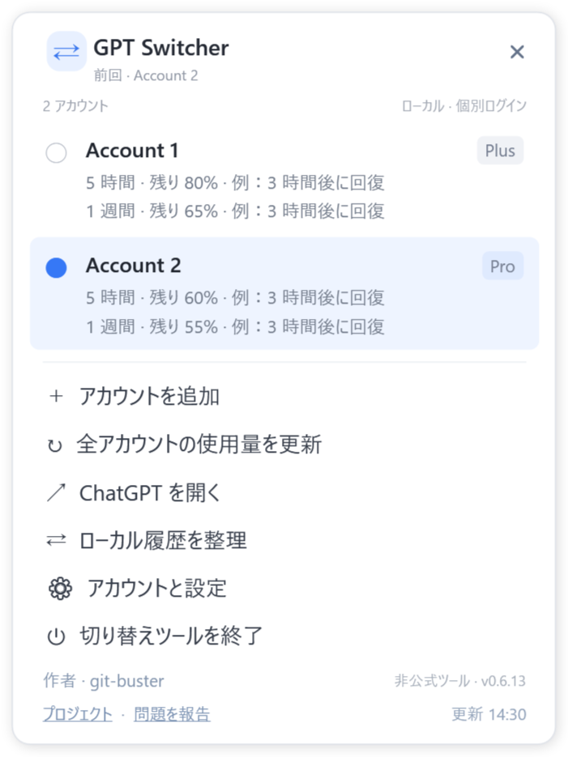
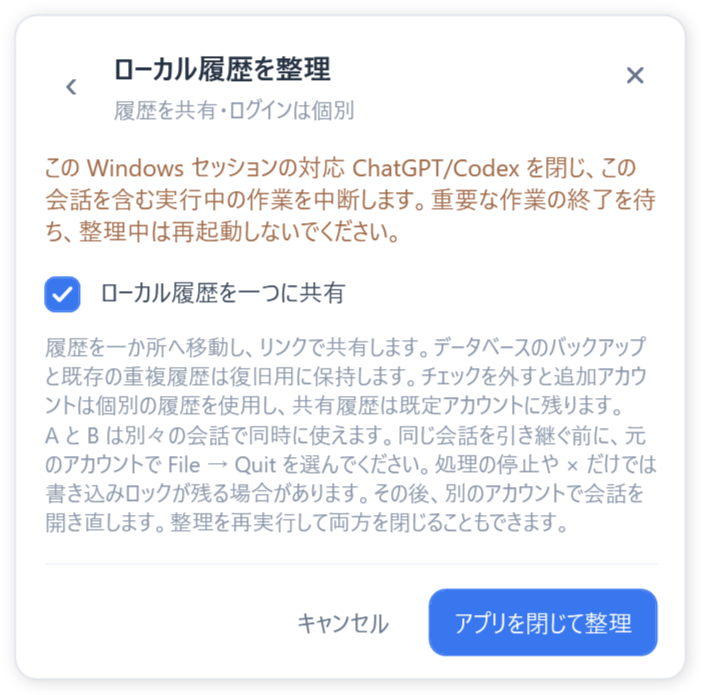

# ローカル履歴の共有

GPT Switcher 0.6.14 · 作者：git-buster

Windows 10/11、.NET Framework 4.8、公式 Codex 補助プログラムを含む完全な対応公式クライアントが必要です。履歴の共有には通常 NTFS のローカルディスクを使います。非対応のクライアントは検証時に拒否します。

1. 古い切り替えツールを終了し、このフォルダーの **ChatGPTAccountSwitcher.exe** を実行します。`.exe.config` は同じ場所に置いてください。インストールは不要です。
2. 通知領域のアイコンを左または右クリックし、「ローカル履歴を整理」を選びます。
3. 「ローカル履歴を一つに共有」をオンにします。重要な作業の終了を待ってから「アプリを閉じて整理」を選んでください。この Windows セッションの対応する公式 ChatGPT/Codex を閉じ、この会話を含む作業を中断します。切り替えツールは動作を続けます。整理中は公式アプリを再起動しないでください。
4. 完了後、各アカウントを開きます。既存アカウントと新しい空のアカウントは、同じローカル履歴と索引を自動的に使用します。独自の履歴が既にあるアカウントは、再度オフライン整理が必要です。
5. A と B を同時に開いて別々の会話で作業できます。同じ会話を引き継ぐ前に、A で **File → Quit** を選び、その後 B で会話を開き直してください。処理の停止や × だけでは、公式アプリの書き込みロックが残る場合があります。整理を再実行して両方を閉じ、その後目的のアカウントを開くこともできます。実行中のモデル処理そのものは移行できません。

履歴は一か所にまとめ、アカウントごとに全体をコピーしません。直近の整理のデータベースと置き換えた重複記録は復旧用に保持します。次の整理が成功すると、プログラムで識別された古いバックアップを削除します。ログインはアカウントごとに維持されます。ローカルプロジェクトも整理時に確認しますが、開いている画面は会話の再読み込みが必要な場合があります。

競合や元の記録の欠落があると整理を停止し、元の記録と復旧情報を保持します。復旧が必要と表示されたら、公式アプリを閉じたまま整理を再実行してください。共有をオフにして整理すると、追加アカウントは個別の履歴を使い、共有履歴は既定アカウントに残ります。その後は v0.6.14 以降を使用してください。

## インストール、アカウント、クライアントの場所

ポータブル版は ZIP を展開して EXE を起動します。設定ファイルを同じ場所に置いてください。MSI は現在の Windows ユーザーにインストールし、デスクトップとスタートメニューにショートカットを作成します。Windows と同時に起動する設定は任意で、既定ではオフです。有効にしても切り替えツールの通知領域アイコンだけを表示します。更新前に古い切り替えツールを終了してください。

対応する完全な公式クライアントは一つだけで利用できます。アカウントを追加して表示名を付け、公式ウィンドウでログインします。他のアプリを開いたままにする選択肢で複数アカウントを同時に開けます。起動済みアカウントをクリックすると、そのウィンドウを表示します。通知領域では左右どちらのクリックも同じパネルを表示します。

最初に検出した場所を保存します。公式実行ファイルや対応するショートカットを手動で選ぶこともできます。**更新や移動後に起動できない場合は、設定の「自動検出 → 保存」を実行してください。**

## 使用量と表示言語

公式補助プログラムが返す Work/Codex のプラン、残量、リセット時刻を表示します。ChatGPT の全機能の上限を示すものではありません。EXE 起動時には更新しますが、通知領域からパネルを開くだけでは更新しません。間隔は **5、10、30 分、1、2 時間、更新しない** から選べます。右下の時刻は最後に成功した取得時刻で、失敗やキャッシュでは変わりません。

表示言語の既定は英語で、簡体字中国語、繁体字中国語、フランス語、日本語にも対応します。作者名は通常の文字で、プロジェクトと報告のボタンから各ページを開けます。

[English](USAGE.md) · [简体中文](README.zh-Hans.md) · [繁體中文](README.zh-Hant.md) · [Français](README.fr.md) · [日本語](README.ja.md)

対応する登録済み公式アプリが更新で別の場所に置き換わった場合、同じアプリ系列の新しいインストールを検証し、その場所を保存します。言語や更新間隔だけを変更する場合、変更していない古い場所の再検証で保存を妨げません。新しく選んだ場所は引き続き検証します。自動復旧できない場合は **自動検出 → 保存** を実行してください。

## 起動時の復旧とアンインストール

元の設定を読めない場合も、パネルを復旧モードで開きます。通知をクリックすると原因を確認できます。可能な場合は独立した専用領域でアカウントを追加し、再ログインできます。履歴は独立し、整理は無効になります。アクセスを直して現行版を再起動すると元の設定を再試行します。管理者権限では設定形式の非互換は解決しません。

MSI 版は **スタート → Uninstall GPT Switcher**、または **Windows 設定 → アプリ → GPT Switcher → アンインストール** で削除できます。切り替えツールを終了し、プログラム、説明、ショートカット、自動起動を削除します。履歴の整理中は終了を待ってください。公式クライアント、ログイン、作業履歴は保持します。ポータブル版は終了してからプログラムのフォルダーを削除します。
