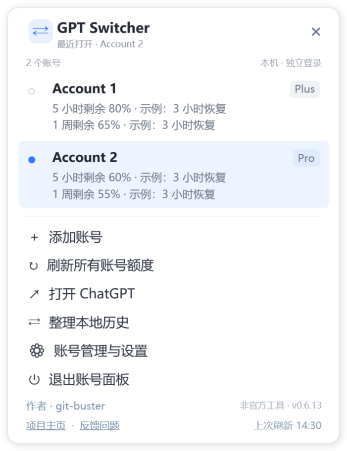
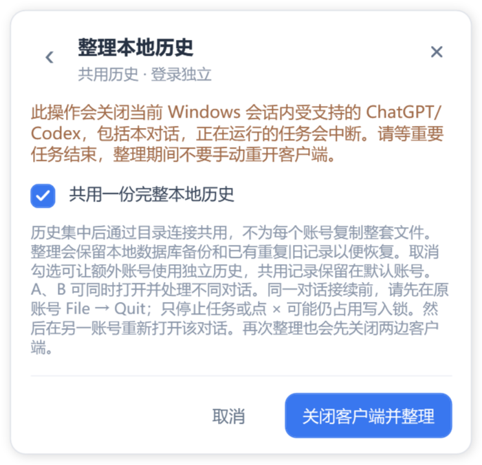

# 本地历史共用说明

GPT Switcher 0.6.14 · 作者：git-buster

需要 Windows 10/11、.NET Framework 4.8，以及自带官方 Codex 辅助程序的完整、受支持官方客户端。本地历史共用需要合适的本地磁盘，通常为 NTFS；不支持的客户端会在检查时被拒绝。

1. 先在旧切换器中选择“退出账号面板”，再运行本文件夹内的 **ChatGPTAccountSwitcher.exe**。旁边的 `.exe.config` 文件需要一起保留，无需安装。
2. 托盘左键、右键均可打开小面板，点击“整理本地历史”。
3. 保持“共用一份完整本地历史”勾选。等重要任务结束后，再点击“关闭客户端并整理”。这会关闭当前 Windows 会话内受支持的官方 ChatGPT/Codex，包括正在阅读的本对话；切换器继续运行。整理期间不要手动重开官方客户端。
4. 等待显示整理完成，再点击账号打开。以后已有账号及新添加的空账号自动共用本地原始历史和索引。若添加的账号已有独立历史，需要再运行一次离线整理。
5. A、B 可以同时打开并处理不同对话。同一对话接续前，请先在 A 内选择 **File → Quit**，然后在 B 重新打开该对话。仅停止任务或点 × 可能仍占用官方程序的写入锁。也可再次点击整理，让切换器先关闭两边再打开目标账号。尚未完成的模型运行过程不能直接搬到另一个账号。

历史集中到一份共同来源，不按账号各复制整套文件。程序保留最近一次整理的数据库备份和被替代的重复旧记录，供恢复使用；下次成功整理后会清理更早、带有程序标记的备份目录。各账号仍分别登录。本地项目入口会在整理时核对；共用文件不等于所有已打开窗口会立即刷新显示。

发现版本冲突或缺失来源记录时，程序停止整理并保留原记录和恢复信息。如提示需要恢复，请保持客户端关闭，再运行“整理本地历史”。取消勾选后执行整理，可让额外账号使用独立历史；已有共用历史保留在默认账号。启用新布局后请使用 v0.6.14 或更新版本，旧版切换器无法读取更新后的设置。

## 安装、添加账号与客户端路径

可以选择免安装 ZIP 或 MSI 安装版。免安装版解压后双击 EXE，并保留旁边的配置文件；MSI 为当前 Windows 用户安装，并创建桌面和开始菜单快捷方式。切换器开机启动可选，默认关闭，也可在软件设置中调整；开启后仅显示切换器托盘图标。升级前先退出已经运行的旧切换器。

只需安装一份完整的受支持官方客户端。点击“添加账号”，填写本地显示名称，然后选择该账号，在官方窗口完成登录。打开另一账号时选择“保留后台，同时打开”，即可多开；点击已运行的账号会唤醒其窗口。托盘左、右键显示同一小面板。

首次检测成功会保存客户端路径；也可手动选择官方程序或受支持的桌面快捷方式，再保存设置。**官方客户端更新或移动后打不开时，点击“账号管理与设置 → 自动检测 → 保存设置”。**

## 额度刷新与语言

“刷新所有账号额度”显示官方辅助程序实际返回的订阅、Work/Codex 剩余额度和恢复时间，不保证包含每项 ChatGPT 功能的额度。双击启动 EXE 时刷新；仅从托盘打开面板不会刷新。定时选项为 **5 分钟、10 分钟、30 分钟、1 小时、2 小时、永不**。“永不”关闭定时刷新。右下角是最后一次成功查询的时间，失败或缓存结果不会改动它。

界面默认英语，可选择简体中文、繁体中文、法语和日语。作者 git-buster 为普通文字，项目主页和反馈按钮可直接跳转。

[English](USAGE.md) · [简体中文](README.zh-Hans.md) · [繁體中文](README.zh-Hant.md) · [Français](README.fr.md) · [日本語](README.ja.md)

受支持的已注册官方客户端更新并替换安装目录后，切换器会核对同一应用系列的新安装并记住新路径。仅修改语言、刷新间隔等选项时，不会因为未改动的旧路径而阻止保存；新选择的路径仍须核验。自动恢复失败时，请使用 **账号管理与设置 → 自动检测 → 保存设置**。

## 启动恢复与卸载

原账号设置暂时读不到时，面板仍会打开并显示恢复提示，点击可查看原因。条件允许时会使用独立的私有恢复工作区，你仍可添加账号并重新登录，历史保持独立；此时不允许整理。解决访问问题后重启当前版本，会重新尝试原工作区。权限、加密和格式问题会分别提示；管理员权限不能解决旧版不认识新版设置的问题。

MSI 安装后，可从 **开始菜单 → Uninstall GPT Switcher**，或 **Windows 设置 → 应用 → GPT Switcher → 卸载** 进行卸载。卸载会退出切换器，移除安装的程序、说明、快捷方式和它自己的开机启动项。若正在整理历史，请先等待完成再卸载。官方客户端、登录资料和工作历史保留。免安装版先退出切换器，再删除程序文件夹即可。
