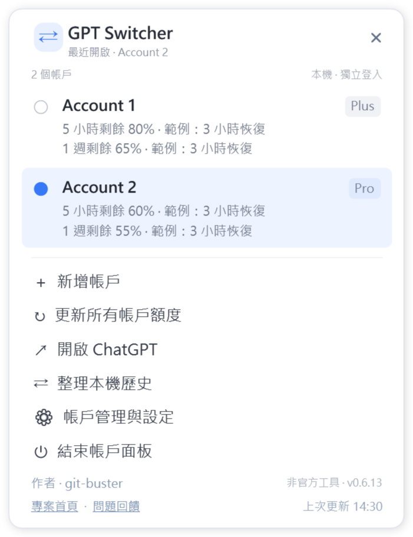
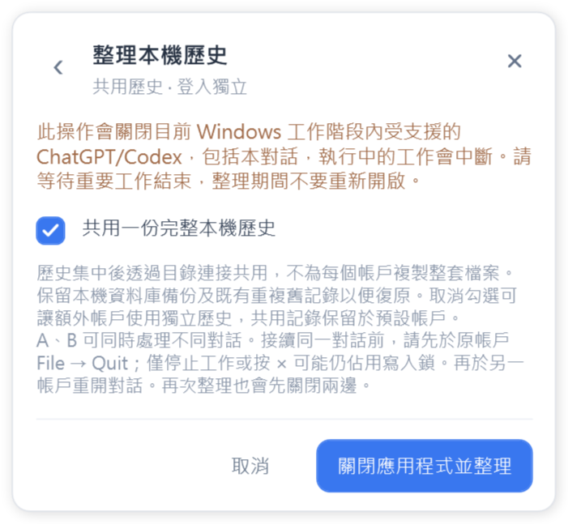

# 本機歷史共用說明

GPT Switcher 0.6.14 · 作者：git-buster

需要 Windows 10/11、.NET Framework 4.8，以及包含官方 Codex 輔助程式的完整受支援用戶端。本機歷史共用需合適的本機磁碟，通常為 NTFS；不支援的用戶端會在檢查時被拒絕。

1. 先在舊切換器選擇退出，再執行此資料夾的 **ChatGPTAccountSwitcher.exe**。請一併保留 `.exe.config`，無須安裝。
2. 左鍵或右鍵點選通知區圖示，選擇「整理本機歷史」。
3. 保持「共用一份完整本機歷史」勾選。等待重要工作結束後，選擇「關閉應用程式並整理」。這會關閉目前 Windows 工作階段內受支援的官方 ChatGPT/Codex，包括目前對話；切換器繼續執行。整理期間請勿重新開啟官方應用程式。
4. 完成後再開啟各帳戶。既有帳戶及新加入的空白帳戶會自動使用共同的原始歷史與索引；已有獨立歷史的帳戶需再次離線整理。
5. A、B 可以同時處理不同對話。接續同一對話前，先在 A 選擇 **File → Quit**，再於 B 重開對話。僅停止工作或按 × 可能仍佔用官方程式的寫入鎖。再次整理也會先關閉兩邊，之後再開啟目標帳戶。尚未完成的模型執行不能直接移轉。

歷史只集中一份，不按帳戶複製整套檔案。保留最近一次操作的資料庫備份與被替代的重複記錄供復原；下次成功整理後清除較舊且帶程式標記的備份。各帳戶登入仍獨立。本機專案入口會在整理時核對；已開啟的視窗可能需要重開對話才能更新。

版本衝突或來源記錄缺失會停止整理並保留原記錄與復原資訊。若提示需要復原，請關閉應用程式後再次整理。取消共用勾選後整理，可讓額外帳戶使用獨立歷史，共同記錄仍留在預設帳戶。新配置需使用 v0.6.14 或更新版本。

## 安裝、帳戶與路徑

免安裝 ZIP 解壓後執行 EXE，並保留旁邊的設定檔。MSI 為目前 Windows 使用者安裝，建立桌面與開始功能表捷徑。切換器隨 Windows 啟動是可選項，預設關閉，也可在設定中變更；啟用後僅開啟切換器通知區圖示。更新前先退出舊切換器。

只需一份完整的受支援官方用戶端。新增帳戶後填寫顯示名稱，再選擇帳戶於官方視窗登入。選擇保留背景即可多開；點選執行中的帳戶會喚醒視窗。左右鍵通知區圖示均開啟相同面板。

首次偵測會記住路徑，也可手動選擇官方程式或受支援的捷徑。**更新或移動後無法開啟時，使用「帳戶設定 → 自動偵測 → 儲存設定」。**

## 額度與語言

額度更新顯示官方實際回傳的 Work/Codex 訂閱、剩餘量及重設時間，不涵蓋所有 ChatGPT 功能。啟動 EXE 時更新，僅開啟通知區面板不更新。定時選項為 **5、10、30 分鐘，1、2 小時，或永不**。右下角顯示最後成功更新時間，失敗與快取結果不改動它。

預設為英語，亦可選簡體中文、繁體中文、法語、日語。作者為普通文字，專案與回饋按鈕可直接開啟網頁。

[English](USAGE.md) · [简体中文](README.zh-Hans.md) · [繁體中文](README.zh-Hant.md) · [Français](README.fr.md) · [日本語](README.ja.md)

受支援的已註冊官方用戶端更新並替換安裝目錄後，切換器會檢查同一應用程式系列的新安裝並記住新路徑。只修改語言、更新間隔等選項時，不會因未變更的舊路徑而阻止儲存；新選擇的路徑仍須驗證。自動復原失敗時，請使用 **帳戶設定 → 自動偵測 → 儲存設定**。

## 啟動復原與解除安裝

讀不到原帳戶設定時，面板仍可開啟，點選復原提示可查看原因。條件允許時會使用獨立私有復原工作區，可新增帳戶並重新登入，使用獨立歷史，暫停整理。修正存取問題後重新啟動目前版本即可重試原工作區。管理員權限無法修正舊版與新版設定格式不相容。

MSI 版本可透過 **開始功能表 → Uninstall GPT Switcher**，或 **Windows 設定 → 應用程式 → GPT Switcher → 解除安裝** 移除。解除安裝會退出切換器並移除程式、說明、捷徑與其自動啟動項；請先等待歷史整理完成。官方用戶端、登入資料和工作歷史保留。免安裝版先退出再刪除程式資料夾。
