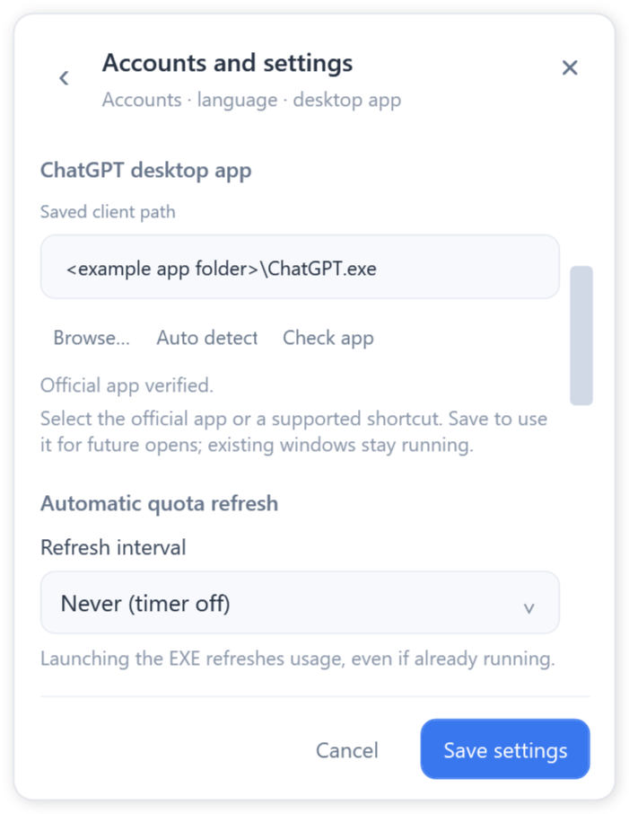
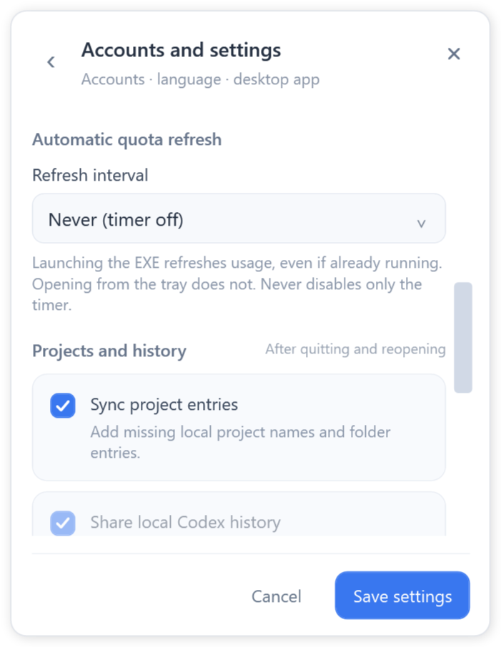

# Local history sharing

GPT Switcher 0.6.14 · Author: git-buster

Requires Windows 10/11, .NET Framework 4.8 and one complete supported official desktop client, including its official Codex helper. Local history sharing needs a suitable local disk, normally NTFS. An unsupported client is rejected during verification.

1. Quit the old switcher using **Exit GPT Switcher**, then run this folder's **ChatGPTAccountSwitcher.exe**. Keep the accompanying configuration file beside it.
2. Open the compact panel from either tray mouse button. Choose **Organize local history**.
3. Leave **Use one shared local history** checked. Read the confirmation, then choose **Close apps and organize** only when important tasks have finished. All supported official ChatGPT/Codex clients in this Windows session close. Do not reopen them during organization.
4. Wait for the completion message. Select the accounts to open them again. Their local original histories and indexes now use one common source. New empty accounts attach automatically; accounts with pre-existing independent history need another offline organization.
5. A and B may run simultaneously on different chats. Before continuing the same chat in B, use **File → Quit** in A, then reopen that chat in B. Stopping a turn or closing with × can leave A's writer lock held. Running organization again also closes both clients first. An unfinished model operation is not transferred.

Local records are consolidated rather than duplicated per account. The latest operation keeps a database snapshot and superseded duplicate records for recovery. A later successful organization removes older marked backup folders. Normal account sign-ins remain separate. Local project entries are refreshed during organization; shared history does not synchronize every window's live view.

Conflicting versions or missing source records stop organization. Originals and recovery information are retained. If recovery is required, keep clients closed and run **Organize local history** again. Clearing the shared-history checkbox starts independent history for extra accounts; existing common history remains in the default account. After changing this layout, use v0.6.14 or newer; old switchers cannot load the updated settings.

## Install, accounts and settings

Choose the portable ZIP or the MSI installer. The portable EXE needs its accompanying configuration file; the MSI creates desktop and Start menu shortcuts. It installs for the current user. Optional **Start GPT Switcher with Windows** is initially off and can also be changed in settings. Startup opens only the switcher tray icon. Quit any old running switcher before updating.

Only one complete supported official client installation is needed. Use **Add account**, enter a local display name, select the account and sign in through its official window. Choose **Keep apps open** to open an additional account alongside others. Selecting an already-running account restores its window. Either tray mouse button opens the same panel.

The first detected client path is saved. You may also choose the official executable or a supported desktop shortcut and save settings. **If opening fails after an official update or move, use Accounts and settings → Auto detect → Save settings.**

## Usage snapshots and languages

**Refresh all usage** queries the official helper for the available plan, remaining Work/Codex quota and reset times. It does not promise allowances for every ChatGPT feature. EXE launches refresh, including a second launch while running; tray opens do not. Choose **5 minutes, 10 minutes, 30 minutes, 1 hour, 2 hours or Never** in settings. Never disables the periodic timer. The lower-right time is the latest successful query; failed or cached results leave it unchanged.

English is the default. Simplified Chinese, Traditional Chinese, French and Japanese are available in **Accounts and settings → Language**. The author credit is plain text. Project and Feedback buttons open the repository and issue page directly.

[English](USAGE.md) · [简体中文](README.zh-Hans.md) · [繁體中文](README.zh-Hant.md) · [Français](README.fr.md) · [日本語](README.ja.md)

When a supported registered official package is replaced by an update, the switcher verifies the current installation from the same application family and remembers its new path. You can save language and refresh preferences without rechecking an unchanged client path. Newly selected paths are still verified. If recovery fails, use **Accounts and settings → Auto detect → Save settings**.

## Startup recovery and uninstall

If the original account settings cannot be opened, the panel still opens in recovery mode. Click its recovery notice for the reason. When possible, a separate private recovery workspace lets you add accounts and sign in again, with independent history. Organization is disabled there. Restart the current version after fixing access to retry the original workspace. Unsupported settings formats and encryption problems are shown separately from permissions. An older version may reject newer settings even when running as administrator.

To uninstall the MSI edition, use **Start → Uninstall GPT Switcher**, or **Windows Settings → Apps → GPT Switcher → Uninstall**. Uninstall closes the switcher, removes the installed program, documentation, shortcuts and its own startup entry. If history organization is running, finish it before uninstalling. Official client installations, account sign-ins and working history are retained. For the portable edition, exit the switcher and remove its program folder.
