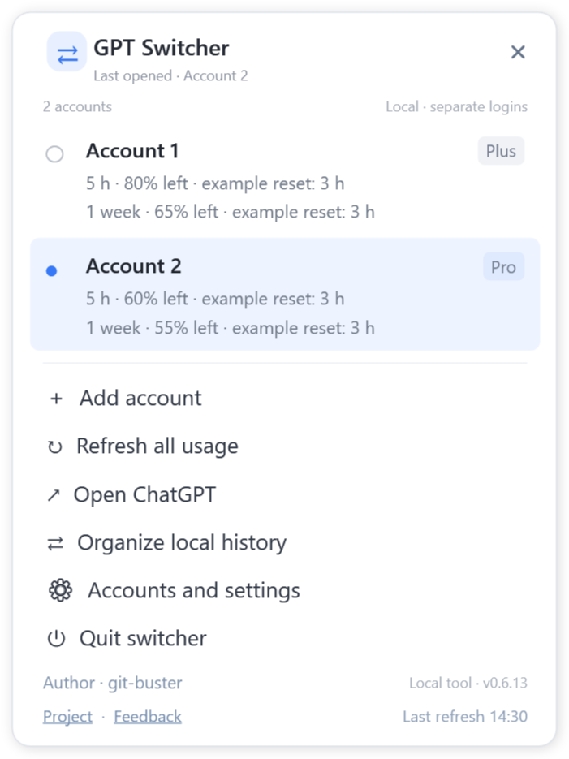
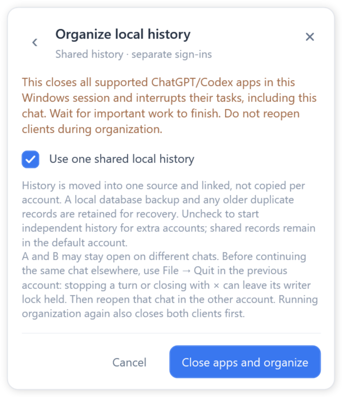

# GPT Switcher for Windows

Author: **git-buster** · Version: **0.6.14** · MIT License

[Portable ZIP](https://github.com/git-buster/GPT_account_switcher/releases/latest/download/ChatGPTDesktopSwitcher-Windows.zip) · [MSI installer](https://github.com/git-buster/GPT_account_switcher/releases/latest/download/ChatGPTDesktopSwitcher-Setup.msi) · [Feedback](https://github.com/git-buster/GPT_account_switcher/issues/new)

[English](Source/docs/USAGE.md) · [简体中文](Source/docs/README.zh-Hans.md) · [繁體中文](Source/docs/README.zh-Hant.md) · [Français](Source/docs/README.fr.md) · [日本語](Source/docs/README.ja.md)

A compact Windows tray panel for multiple official ChatGPT accounts, Work/Codex usage snapshots and shared local history. Desktop/EXE launches and either tray mouse button open the same small panel near the notification icon. **English is the default.**

## Choose a download

| Folder | Contents | Use |
| --- | --- | --- |
| [Portable](Portable) | Ready-to-run EXE, configuration, guides and checksums | Extract the portable ZIP and double-click the EXE. Keep its configuration file beside it. |
| [Installer](Installer) | Per-user Windows MSI and checksums | Install with desktop and Start menu shortcuts. Windows startup is optional and initially off. |
| [Source](Source) | Buildable source, scripts, guides and illustrations | See the [source README](Source/README.md). |

Requires Windows 10/11, .NET Framework 4.8 and one complete supported official ChatGPT/Codex desktop client. Shared history requires a suitable local disk, normally NTFS. One official installation supports multiple account windows; add accounts and sign in through their official windows.

## Features

- Add, rename and restore multiple accounts from one compact panel.
- Keep existing clients open, or explicitly close supported clients before opening another account.
- View returned plan, remaining Work/Codex usage and reset times. See the last successful refresh at the lower right.
- Refresh when launching the EXE, including re-launching it while running; opening the tray panel does not refresh. Optional intervals: 5, 10 or 30 minutes; 1 or 2 hours; Never.
- Save the detected complete official client path, or choose an executable / supported shortcut. **After an update or move, use Accounts and settings → Auto detect → Save settings if opening fails.**
- Organize local history with explicit client closure, recovery backups, history checks and local project-entry updates. New empty accounts automatically attach after sharing is enabled.
- Choose common or independent history through the organization page.
- Use English, Simplified Chinese, Traditional Chinese, French or Japanese.

## Share local work

Quit an older running switcher before opening this version. Wait for important tasks to finish, then select **Organize local history → Use one shared local history → Close apps and organize**. This interrupts remaining official tasks and closes supported clients in the current Windows session. Wait for completion before opening accounts again.

**Different chats can run in A and B simultaneously. To continue the same chat, use File → Quit in A first, then reopen it in B.** Stopping a turn or closing with × can leave its writer lock held. Running organization again closes both clients first. An unfinished model operation is not transferred. Missing records or conflicting versions stop organization rather than being overwritten.

Read the illustrated guide in your language for setup, history modes and troubleshooting. [Security](SECURITY.md) · [Report an issue](https://github.com/git-buster/GPT_account_switcher/issues/new).

This project is independent of OpenAI. Use only accounts you are authorized to access and follow the applicable service terms.

Updates to a supported registered official package are recovered by verifying the current installation from the same application family and remembering its new path. An unchanged app path does not block saving language or refresh preferences; newly selected paths are still checked. If recovery fails, use **Auto detect → Save settings**.

## Recovery and uninstall

The panel opens even when original account settings are unavailable. Recovery mode explains the cause and, when possible, offers a separate private workspace for new sign-ins; history organization is disabled until original access is restored. Restart the current version after fixing access. Administrator mode does not repair an incompatible settings format.

The MSI adds **Uninstall GPT Switcher** to the Start menu. Windows Apps settings also supports uninstall. Installed program files, guides, shortcuts and the switcher’s own startup entry are removed; official clients, sign-ins and working history are retained. Wait for any organization to finish first.
